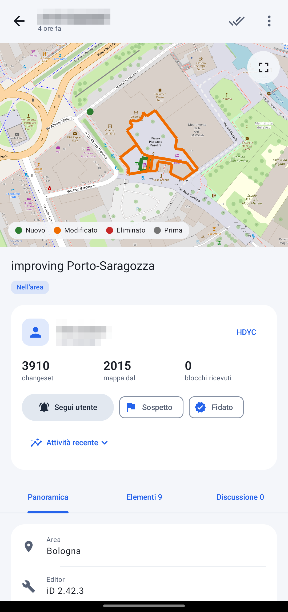
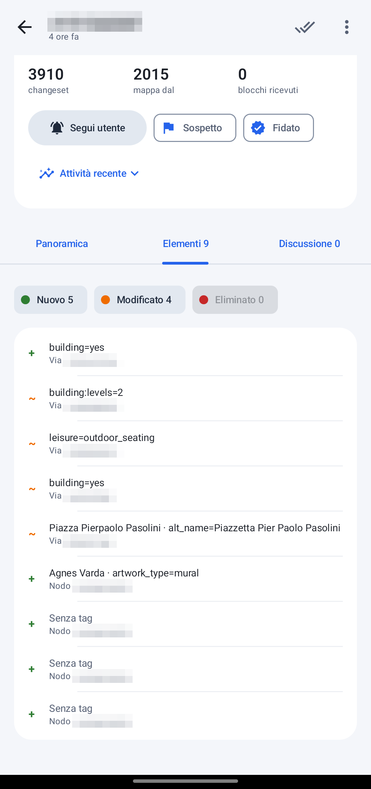
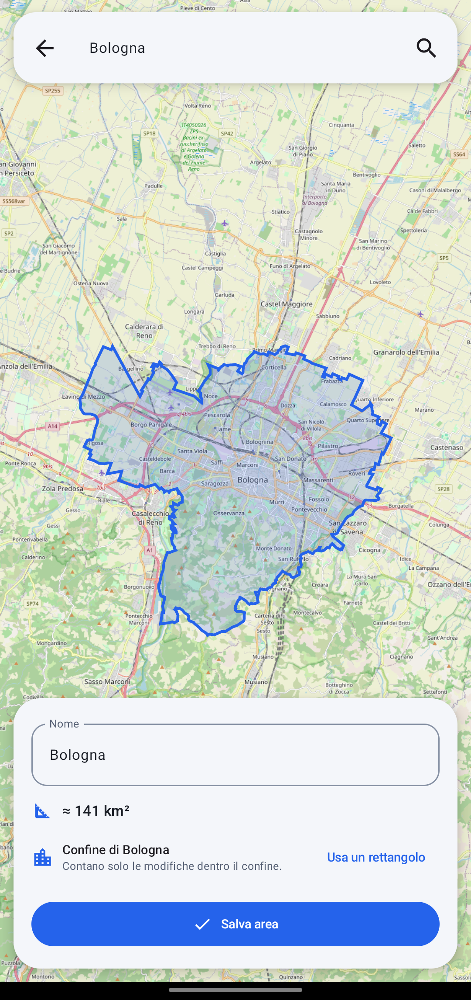
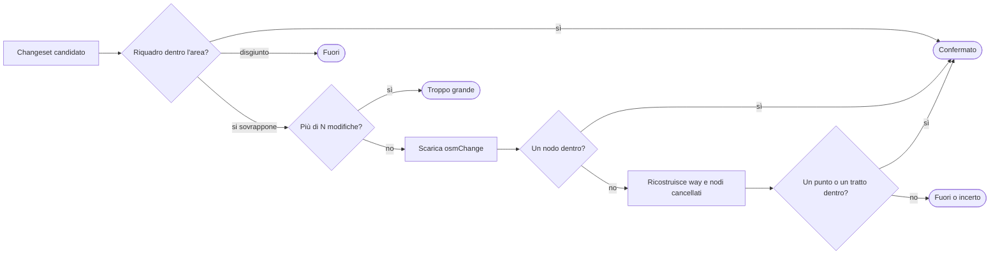

<div align="center">


# OSM Changeset Watch

**Sai cosa cambia su OpenStreetMap nella tua zona, appena succede.**

Scegli un comune o disegna un'area: l'app controlla i changeset in background, scarta quelli che la sfiorano soltanto e ti avvisa di quelli che la toccano davvero. Per ognuno mostra cosa è cambiato, chi l'ha fatto e se vale la pena guardarlo meglio, come OSMCha ma sul telefono.

[](LICENSE)
[](#build)
[](#build)
[](#privacy)

</div>

| Lista | Dettaglio | Elementi | Confine del comune |
|:---:|:---:|:---:|:---:|
|  |  |  |  |

## Cosa fa

### Osserva
- **Comuni e luoghi veri.** Cerca un comune con Nominatim e l'area segue il suo confine reale, non un rettangolo. In alternativa disegni il rettangolo a mano.
- **Utenti, ovunque nel mondo.** Segui un mapper e vedi tutti i suoi changeset, in qualunque posto.
- **Notifiche raggruppate per area**, con un controllo in background ogni 15 minuti o fino a 6 ore.

### Filtra il rumore
- **Verifica geometrica.** L'API restituisce ogni changeset il cui riquadro *interseca* l'area, anche se copre mezza Europa. L'app scarica le modifiche e tiene solo quelli con almeno un elemento dentro.
- **Segnali in stile OSMCha:** molte modifiche, nessun commento, cancellazioni in massa, mapper nuovo, utente già bloccato, utente sospetto.
- **Filtri** per dimensione, data, editor, hashtag e tipo di modifica (solo cancellazioni, solo creazioni…).
- **Liste di utenti fidati e sospetti**, per nascondere o evidenziare chi conosci.
- Una **ricerca** per utente, commento, editor o id, e **"Carica altri"** in fondo alla lista per andare indietro nel tempo.

### Capisci cosa è successo
- **Mappa del changeset:** in verde ciò che è nuovo, in arancione il modificato, in rosso tratteggiato l'eliminato. La forma precedente resta visibile in grigio.
- **Elenco degli elementi cambiati**, comprese le relation: tag aggiunti, cambiati e rimossi, nodi spostati, membri aggiunti e tolti.
- **Cronologia di ogni elemento dentro l'app**, versione per versione, con le differenze e il link al changeset che l'ha fatta.
- **Scheda dell'autore**, con iscrizione, numero di changeset, blocchi ricevuti e un riepilogo dell'attività recente nello stile di HDYC.
- **Discussione:** leggi i commenti e, con il login OSM, rispondi direttamente al mapper.
- Link rapidi a osm.org, iD, Achavi e OSMCha. L'app apre anche i link `openstreetmap.org/changeset/…` che arrivano da altre app.

## Come funziona la verifica



1. Se il riquadro del changeset è tutto dentro l'area, il changeset è confermato senza scaricare nulla. Se è del tutto fuori, viene scartato.
2. Sopra le *N* modifiche (2000 di default, in Impostazioni → Filtro) il changeset non viene scaricato.
3. Altrimenti l'app scarica `GET /changeset/{id}/download` e cerca un nodo creato o modificato dentro l'area.
4. Poi ricostruisce la geometria. Le coordinate dei nodi cancellati vengono dalla versione precedente (`nodes?nodes=idv(N-1)`). Per le way, i nodi assenti dall'`osmChange` arrivano con un multi-fetch. Un punto dentro, o un tratto che attraversa il confine, basta a confermare.
5. Se non trova nessun contatto, il changeset è **fuori** quando la ricostruzione è completa e **incerto** quando è parziale o contiene relation. I changeset incerti restano visibili con il filtro "Anche non verificati".

## Privacy

- **Nessun account obbligatorio, nessuna pubblicità, nessun tracker.** Niente Google Play Services, Firebase, analytics o crash reporter.
- **Il login OSM è facoltativo** e serve solo per commentare. Usa OAuth2 con PKCE, senza segreti dentro l'app, e chiede il solo permesso `write_changeset_comments`. Il token è cifrato con l'Android Keystore.
- **Permessi:** `INTERNET`, `ACCESS_NETWORK_STATE` e `POST_NOTIFICATIONS` (da Android 13). Nessun accesso alla posizione.

## Rispetto per i server OSM

- **API:** l'app legge in forma anonima da `api.openstreetmap.org/api/0.6` e si identifica con il proprio User-Agent (`OsmConfig.USER_AGENT`).
  - Fa una richiesta alla volta, con pause tra una e l'altra.
  - Su 429 e 5xx riprova con backoff esponenziale e rispetta `Retry-After`.
  - Al massimo 25 download di verifica per giro; il resto aspetta il giro successivo.
  - Vedi la [policy dell'API](https://operations.osmfoundation.org/policies/api/).
- **Nominatim:** cerca solo quando premi invio, senza autocompletamento, con al massimo una richiesta al secondo. Vedi la [policy di Nominatim](https://operations.osmfoundation.org/policies/nominatim/).
- **Tile:** usa i tile pubblici di OpenStreetMap, con 50 MB di cache e nessun prefetch. Vedi la [Tile Usage Policy](https://operations.osmfoundation.org/policies/tiles/).

## Limiti noti

- Le relation sono elencate con i membri cambiati, ma non vengono disegnate. Un changeset con sole relation dentro l'area risulta **incerto**.
- Le way cancellate sono disegnate con la posizione *attuale* dei loro nodi, che nel frattempo può essere cambiata.
- I tile OSM arrivano allo zoom 19. Oltre, fino al 21, lo sfondo è ingrandito e meno nitido, mentre le geometrie restano nitide.
- I controlli in background sono approssimativi: Doze e il risparmio energetico possono ritardarli, perché l'app non usa un foreground service.
- I riquadri che attraversano l'antimeridiano non sono gestiti.

## Build

```sh
./gradlew testDebugUnitTest     # test JVM: parser, geometria, verifica, client
./gradlew assembleDebug         # APK di debug
./gradlew assembleRelease       # release con R8
OSM_LIVE=1 ./gradlew testDebugUnitTest --tests "*LiveVerifyTest*" -i   # prova sull'API vera
```

- Serve JDK 17, con Android SDK 35 e il Gradle wrapper. Nessuno step scarica binari, solo dipendenze Maven.
- La release viene firmata solo se esporti `OSMWATCH_KEYSTORE`, `_KEYSTORE_PASSWORD`, `_KEY_ALIAS` e `_KEY_PASSWORD`.

**Stack:**
- Kotlin, Jetpack Compose e Material 3, Room, WorkManager;
- OkHttp;
- [osmdroid](https://github.com/osmdroid/osmdroid), scelto al posto di MapLibre Native perché è solo Java, non ha librerie native e non ha dipendenze transitive.

Tutte le dipendenze sono FOSS. `dependenciesInfo` è disattivato, quindi nell'APK non c'è un blocco opaco.

<details>
<summary><b>Checklist F-Droid</b></summary>

- [x] Licenza FOSS (GPL-3.0), con `LICENSE` nel repo
- [x] Build Gradle standard, nessun binario scaricato, nessun servizio proprietario
- [x] Metadati Fastlane in `fastlane/metadata/android/{en-US,it-IT}`
- [x] Nessuna Anti-Feature: dati e tile vengono da servizi OpenStreetMap liberi
- [x] `.gitattributes` con `eol=lf`
- [x] Repository pubblico
- [x] Screenshot aggiornati alla nuova interfaccia
- [ ] Tag `v1.0.0` e richiesta di inclusione a `fdroiddata`

</details>

---

<div align="center">
<sub>Dati © <a href="https://www.openstreetmap.org/copyright">OpenStreetMap contributors</a> (ODbL) · Licenza <a href="LICENSE">GPL-3.0</a></sub>
</div>
