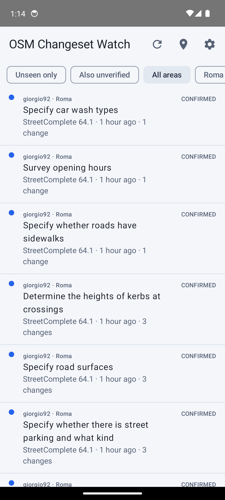
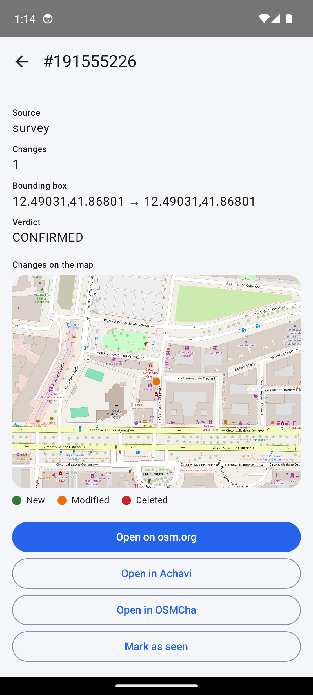
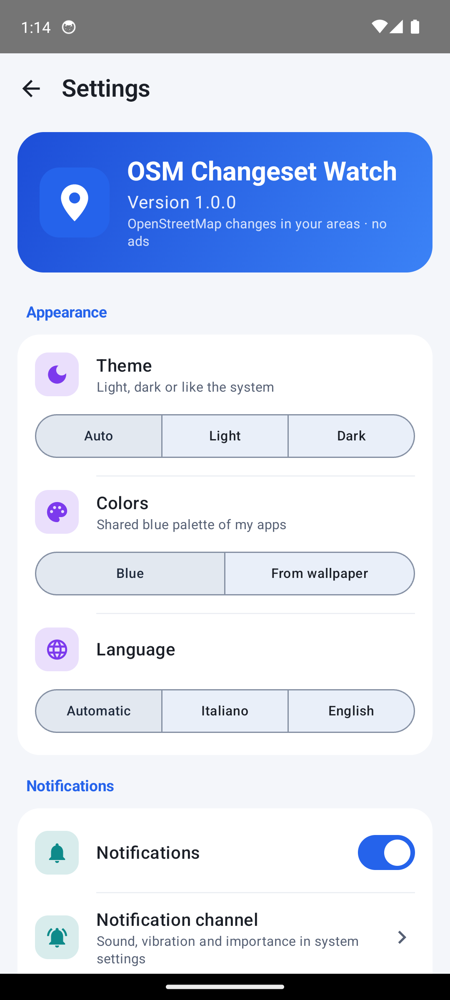

# OSM Changeset Watch

App Android (Kotlin, Jetpack Compose) che controlla i **changeset di OpenStreetMap** nelle aree che disegni sulla mappa e ti avvisa con una notifica. Nessun account, nessuna pubblicità, nessun servizio Google, nessun tracker. Licenza **GPL-3.0** (stessa di ParkMap).

| Lista | Minimappa | Impostazioni |
|---|---|---|
|  |  |  |

## Cosa fa
- **Aree**: rettangolo trascinabile su mappa osmdroid, superficie in km², avviso se molto grande.
- **Filtro vero**: l'API restituisce ogni changeset la cui bbox *interseca* l'area, anche se enorme. Ogni candidato viene verificato (`ChangesetVerifier`) e la lista mostra solo quelli con almeno un elemento dentro l'area. "Anche non verificati" mostra il resto.
- **Minimappa** del changeset: nuovo (verde), modificato (arancione), eliminato (rosso tratteggiato). Tocco su un elemento: tag aggiunti/cambiati/rimossi, spostamento, nodi aggiunti/tolti.
- **Notifiche** raggruppate per area; controllo in background con WorkManager (15 min – 6 h).
- Apertura del changeset su osm.org, Achavi, OSMCha. Italiano e inglese; tema, colori (blu / Material You) e lingua nelle impostazioni (stesso schema di ParkMap).

## Come funziona la verifica
1. bbox del changeset dentro l'area → confermato (nessun download); disgiunta → fuori.
2. Più di *N* modifiche (default 2000, Impostazioni → Filtro) → `SKIPPED_TOO_LARGE`, non scaricato.
3. Altrimenti `GET /changeset/{id}/download`: un nodo creato/modificato dentro l'area → confermato.
4. Poi si ricostruisce la geometria: nodi cancellati (le coordinate non sono nel `osmChange`: si usa la versione precedente, `nodes?nodes=idv(N-1)`), way (nodi dal `osmChange`, gli altri via multi-fetch). Un punto dentro o un tratto che attraversa l'area → confermato.
5. Nessun contatto: `OUTSIDE` se la ricostruzione è completa, `UNCERTAIN` se parziale o con relation.

Download **uno alla volta**, 1 s di pausa, al massimo 25 verifiche per area e per giro (il resto resta `PENDING`).

## Limiti noti
- Le **relation** non sono disegnate né risolte; un changeset con sole relation dentro l'area risulta `UNCERTAIN`.
- Le way **cancellate** usano la posizione *attuale* dei nodi, che può essere cambiata.
- Controlli in background **approssimativi**: Doze e risparmio energetico possono ritardarli; nessun foreground service. Il lavoro riprova con backoff se la rete manca.
- Bbox che attraversano l'antimeridiano: non gestite (ignorate).
- La mappa usa i tile pubblici di OpenStreetMap con User-Agent dell'app, cache da 50 MB e nessun prefetch; per uso intensivo la [Tile Usage Policy](https://operations.osmfoundation.org/policies/tiles/) suggerisce un provider dedicato.
- Il refresh completo può durare qualche decina di secondi (verifiche sequenziali).

## Uso dell'API OSM (policy)
Solo lettura anonima di `api.openstreetmap.org/api/0.6`. User-Agent `OSMChangesetWatch/<versione> (<URL repo>)` in `OsmConfig.USER_AGENT` (da tenere allineato a `versionName`). Una richiesta alla volta, pause tra richieste, timeout 15/30 s, **backoff esponenziale** su 429/5xx e rispetto di `Retry-After`. Nessun polling aggressivo: intervallo minimo 15 min. [Policy ufficiale](https://operations.osmfoundation.org/policies/api/).

La ricerca di comuni e luoghi nell'editor delle aree usa [Nominatim](https://nominatim.openstreetmap.org/) (stesso User-Agent): solo su invio esplicito, niente autocompletamento, al massimo una richiesta al secondo, come chiede la [policy di Nominatim](https://operations.osmfoundation.org/policies/nominatim/).

## Scelta della mappa
osmdroid 6.1.20 (Apache-2.0, nessuna dipendenza transitiva, solo Java) invece di MapLibre Native (librerie native pesanti, più rischio per F-Droid).

## Build
```
./gradlew testDebugUnitTest      # test JVM (parser, geometria, verifier, client)
./gradlew assembleDebug          # APK di debug
./gradlew assembleRelease        # release (R8), firmata solo se esportate OSMWATCH_KEYSTORE / _KEYSTORE_PASSWORD / _KEY_ALIAS / _KEY_PASSWORD
OSM_LIVE=1 ./gradlew testDebugUnitTest --tests "*LiveVerifyTest*" -i   # prova reale sull'API
```
JDK 17, Android SDK 35, Gradle wrapper. Nessuno step scarica binari: solo dipendenze Maven verificabili.

## Permessi
`INTERNET`, `ACCESS_NETWORK_STATE`, `POST_NOTIFICATIONS` (Android 13+). Nessun permesso di posizione.

## Dipendenze (tutte FOSS)
AndroidX (Core, Lifecycle, Activity, WorkManager, Room), Jetpack Compose + Material 3 (+ icons-extended), OkHttp/Okio (Apache-2.0), osmdroid (Apache-2.0), Kotlin stdlib, `listenablefuture` (stub Guava, Apache-2.0). Solo test: JUnit, MockWebServer, kxml2. Verificato con `:app:dependencies`: nessun Google Play Services, Firebase, analytics o crash reporter. `dependenciesInfo` disattivato (niente blocco opaco nell'APK).

## Checklist F-Droid
- [x] Licenza FOSS (GPL-3.0), `LICENSE` nel repo
- [x] Build Gradle standard, nessun binario scaricato, nessun servizio proprietario
- [x] Metadati Fastlane (`fastlane/metadata/android/{en-US,it-IT}`: titolo, descrizioni, changelog 100, screenshot)
- [x] Anti-Feature: nessuna (dati e tile da servizi OpenStreetMap, liberi)
- [x] `.gitattributes` con `eol=lf` (il wrapper `gradlew` resta eseguibile su Linux)
- [ ] Repository pubblico `github.com/AndreaDp271/OsmChangesetWatch` (l'URL è già nel User-Agent)
- [ ] Tag `v1.0.0` e richiesta di inclusione a `fdroiddata`

## Dati
Dati © OpenStreetMap contributors (ODbL).
